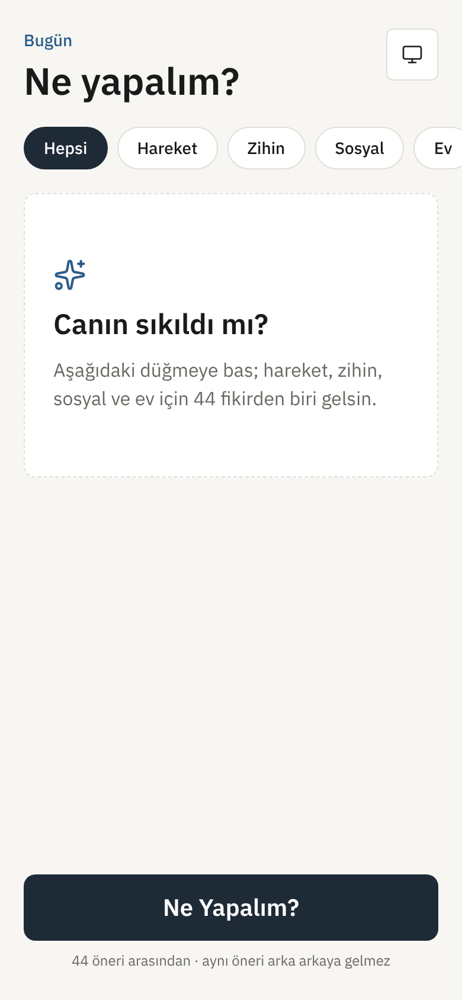
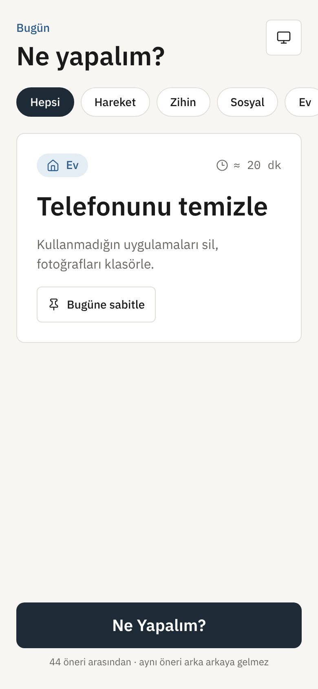
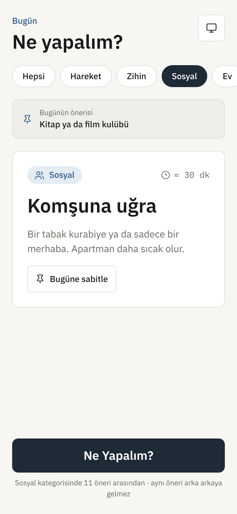
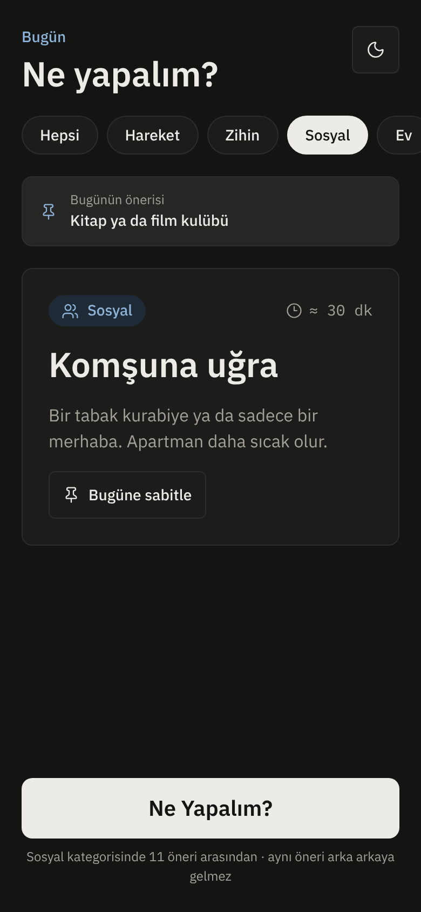
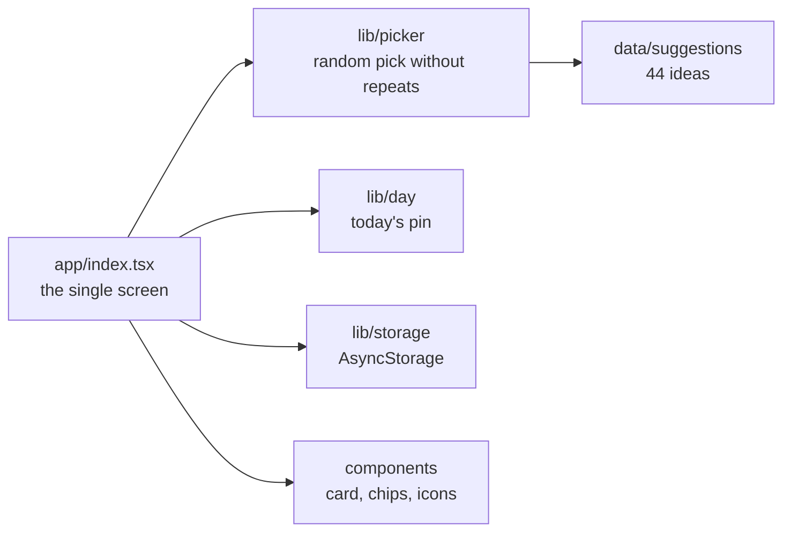

# Bugün Ne Yapalım?

**English** · [Türkçe](README.tr.md)

*"What shall we do today?"* A small mobile app that suggests an activity with one tap: something to move, think, meet people or tidy up.

[](https://github.com/Beratoguzhan620/bugun-ne-yapalim/actions/workflows/ci.yml)


<p align="center"></p>

## Try it

```bash
pnpm install
pnpm web        # in the browser
pnpm start      # then scan the QR code with Expo Go
```

## Features

- **One tap, one idea:**
  - 44 activities in four categories: Move, Mind, Social and Home.
  - Each card says what to do and roughly how long it takes.
- **No repeats:** the current idea never comes again right away, and the last eight are held back while anything else is left.
- **Category filter:** chips at the top limit the ideas to one category.
- **Pin today's idea:** the pin lasts for the day. Opening the app later that day shows it first, and a banner brings it back after you tap on.
- **Light, dark or system theme:** the choice is remembered.
- **Feel:**
  - IBM Plex Sans across the app.
  - A short fade on each new card, and light haptic feedback on phones.
  - Touch targets of at least 44 px.
- **Store-ready:**
  - App icon, Android adaptive icon layers, and light and dark splash screens.
  - Bundle identifiers and the store texts in [docs/store.md](docs/store.md).
- **Private:** no account, no ads, no network calls. Preferences stay on the device.

## Screenshots

| Start | Idea | Pinned | Dark |
|---|---|---|---|
|  |  |  |  |

## Tech stack

- Expo SDK 58 (managed), React Native 0.88, expo-router, TypeScript in strict mode
- NativeWind (Tailwind): every style is a `className`; CI fails on inline styles. Colours and type come from [docs/DESIGN.md](docs/DESIGN.md), including the dark palette.
- @expo-google-fonts/ibm-plex-sans with expo-font, Reanimated for the card animation, expo-haptics, AsyncStorage
- Vitest for the picking logic, Playwright for an end-to-end flow on the web build
- GitHub Actions: type check, lint, inline-style check, unit tests, web build and the end-to-end flow

## How it is built



- `pickNext` takes the pool, the category, the current idea and the recent ones, plus an optional random source so tests can make it predictable.
- A pin is stored as `{ day, id }` and only counts on the day it was made, so yesterday's pin disappears on its own.

## Scripts

| Command | What it does |
|---|---|
| `pnpm start` / `pnpm web` | Expo dev server (native / web) |
| `pnpm typecheck` | `tsc --noEmit` |
| `pnpm lint` | ESLint (expo config) |
| `pnpm test` | Unit tests |
| `pnpm build:web` | Static web build in `dist/` |
| `pnpm serve:web` | Serve `dist/` on port 8090 |
| `pnpm test:e2e` | End-to-end flow against the served build |
| `pnpm media:readme` | Record the README screenshots and walkthrough |

## Tests

```bash
pnpm test
```

The unit tests cover:

- **The ideas:** at least 40, unique ids, every category covered, and every card complete.
- **Picking:**
  - The current idea never comes back right away, and picks stay inside the category.
  - Recent ideas are avoided, with a fallback once everything has been seen.
  - The edges of the random source are handled, and all 44 ideas come up over time.
- **Pins and formatting:** pins expire with the day; durations are formatted.

The end-to-end flow runs in a real browser on phone and desktop sizes:

- It taps through a dozen ideas without a repeat and filters by category.
- It pins an idea and checks the pin after a reload.
- It switches to the dark theme and checks the colours.
- It fails if the page scrolls sideways.

## Roadmap and known gaps

- Live web demo.
- Store submission builds with EAS.
- A notification with the day's idea.

## Background

This project started as a bootcamp project and was later rebuilt from the ground up. The assignment asked for an Expo app that shows a random activity from an array, styled with NativeWind, with a custom font, an icon, a splash screen and store information. What this version adds:

- **Ideas:** 44 ideas with categories, durations and a picker that avoids repeats.
- **Features:** a category filter, pinning an idea to the day, and a dark theme.
- **Design:** a design system shared with my other projects, an original icon and light and dark splash screens.
- **Quality:** unit tests, an end-to-end browser flow, an inline-style guard and CI on every pull request.

## License

[MIT](LICENSE) · Berat Oğuzhan Turğut · [GitHub](https://github.com/Beratoguzhan620)
