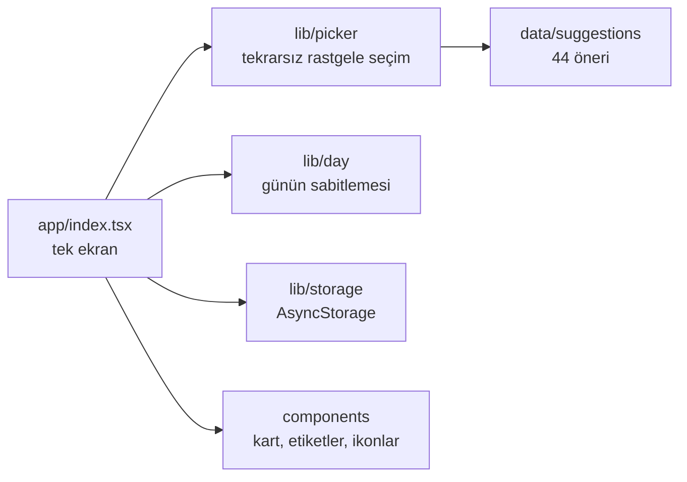

# Bugün Ne Yapalım?

[English](README.md) · **Türkçe**

Tek dokunuşla aktivite öneren küçük bir mobil uygulama: hareket, zihin, sosyal ya da ev için bir fikir.

[](https://github.com/Beratoguzhan620/bugun-ne-yapalim/actions/workflows/ci.yml)


<p align="center"></p>

## Dene

**Canlı demo:** [beratoguzhan620.github.io/bugun-ne-yapalim](https://beratoguzhan620.github.io/bugun-ne-yapalim/) (web sürümü; `main`'den `.github/workflows/deploy.yml` ile yayınlanır)

```bash
pnpm install
pnpm web        # tarayıcıda
pnpm start      # sonra QR kodu Expo Go ile okut
```

## Özellikler

- **Tek dokunuş, tek fikir:**
  - Dört kategoride 44 aktivite: Hareket, Zihin, Sosyal ve Ev.
  - Her kartta ne yapılacağı ve yaklaşık ne kadar süreceği yazar.
- **Tekrar yok:** ekrandaki öneri hemen tekrar gelmez; başka seçenek kaldıkça son sekiz öneri de bir süre bekletilir.
- **Kategori filtresi:** üstteki etiketler önerileri tek bir kategoriyle sınırlar.
- **Günün önerisini sabitle:** sabitleme o gün boyunca geçerlidir. Gün içinde uygulamayı açınca ilk o görünür; başka önerilere geçince bir bant onu geri getirir.
- **Açık, koyu ya da sistem teması:** seçim hatırlanır.
- **His:**
  - Tüm uygulamada IBM Plex Sans.
  - Her yeni kartta kısa bir geçiş animasyonu; telefonda hafif titreşim.
  - Dokunma alanları en az 44 px.
- **Store'a hazır:**
  - Uygulama simgesi, Android uyarlanabilir simge katmanları, açık ve koyu açılış ekranı.
  - Paket kimlikleri ve [docs/store.md](docs/store.md) içindeki store metinleri.
- **Gizlilik:** hesap, reklam ya da ağ bağlantısı yok. Tercihler yalnızca cihazda saklanır.

## Ekran görüntüleri

| Başlangıç | Öneri | Sabitlenmiş | Koyu |
|---|---|---|---|
|  |  |  |  |

## Teknolojiler

- Expo SDK 58 (managed), React Native 0.88, expo-router, strict modda TypeScript
- NativeWind (Tailwind): bütün stiller `className` ile; satır içi stil kullanılırsa CI başarısız olur. Renkler ve yazı ölçeği, koyu palet dahil [docs/DESIGN.md](docs/DESIGN.md)'den geliyor.
- expo-font ile @expo-google-fonts/ibm-plex-sans, kart animasyonu için Reanimated, expo-haptics, AsyncStorage
- Öneri seçme mantığı için Vitest, web build üzerindeki uçtan uca akış için Playwright
- GitHub Actions: tip kontrolü, lint, satır içi stil kontrolü, birim testleri, web build ve uçtan uca akış

## Nasıl kuruldu



- `pickNext` öneri listesini, kategoriyi, ekrandaki ve son görülen önerileri alır. Testlerin sonucu sabitleyebilmesi için rastgele sayı kaynağı da dışarıdan verilebilir.
- Sabitleme `{ day, id }` olarak saklanır ve yalnızca yapıldığı gün geçerlidir; dünkü sabitleme kendiliğinden düşer.

## Komutlar

| Komut | Ne yapar |
|---|---|
| `pnpm start` / `pnpm web` | Expo geliştirme sunucusu (telefon / web) |
| `pnpm typecheck` | `tsc --noEmit` |
| `pnpm lint` | ESLint (expo ayarları) |
| `pnpm test` | Birim testleri |
| `pnpm build:web` | `dist/` klasörüne statik web çıktısı |
| `pnpm serve:web` | `dist/` klasörünü 8090 portunda sunar |
| `pnpm test:e2e` | Sunulan web çıktısı üzerinde uçtan uca akış |
| `pnpm media:readme` | README ekran görüntülerini ve kısa turu kaydeder |

## Testler

```bash
pnpm test
```

Birim testleri şunları kapsıyor:

- **Öneriler:** en az 40 tane, benzersiz kimlikler, her kategori dolu, her kart eksiksiz.
- **Seçim:**
  - Ekrandaki öneri hemen tekrar gelmez; seçim kategorinin içinde kalır.
  - Son görülenlerden kaçınılır; hepsi görüldüyse onlara geri dönülür.
  - Rastgele sayı kaynağının uç değerleri sorun çıkarmaz; zamanla 44 önerinin hepsi gelir.
- **Sabitleme ve biçim:** sabitleme günle birlikte sona erer; süreler doğru biçimlenir.

Uçtan uca akış gerçek bir tarayıcıda, telefon ve masaüstü boyutunda çalışır:

- Tekrarsız bir düzine öneri alır ve kategoriye göre filtreler.
- Bir öneriyi sabitler, sayfa yenilenince sabitlemeyi kontrol eder.
- Koyu temaya geçip renkleri kontrol eder.
- Sayfa yana kayarsa başarısız olur.

## Yol haritası ve bilinen eksikler

- EAS ile store'a gönderilecek build'ler.
- Günün önerisini bildiren bir bildirim.

## Geçmiş

Bu proje bir bootcamp projesi olarak başladı, sonra baştan geliştirildi. Ödev, bir diziden rastgele aktivite gösteren, NativeWind ile stillenmiş, özel yazı tipi, simge, açılış ekranı ve store bilgileri olan bir Expo uygulamasıydı. Bu sürümün ekledikleri:

- **Öneriler:** kategorili ve süreli 44 öneri; tekrar etmeyen bir seçim mantığı.
- **Özellikler:** kategori filtresi, günün önerisini sabitleme ve koyu tema.
- **Tasarım:** diğer projelerimle ortak tasarım sistemi, özgün simge, açık ve koyu açılış ekranı.
- **Kalite:** birim testleri, uçtan uca tarayıcı testi, satır içi stil denetimi ve her pull request'te CI.

## Lisans

[MIT](LICENSE) · Berat Oğuzhan Turğut · [GitHub](https://github.com/Beratoguzhan620)
